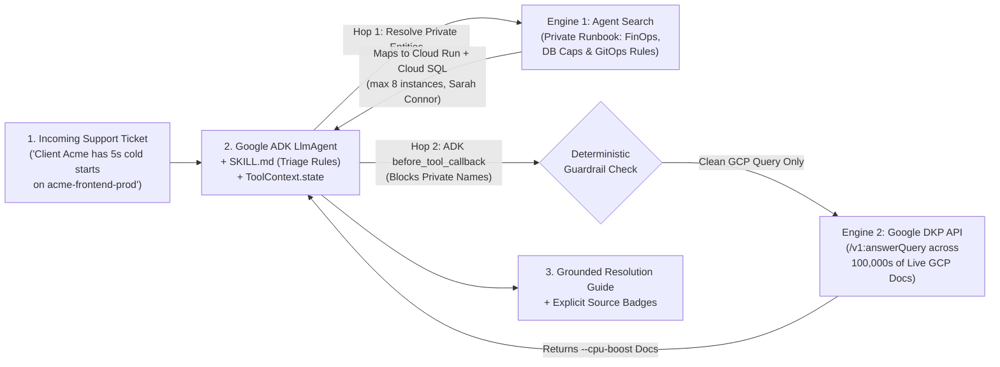

# Dual-Engine AI Support Assistant (Google ADK + Agent Search + Developer Knowledge API + Agent Skills)

A production-pattern **Dual-Engine AI Support Assistant** built with the **Google Agent Development Kit (`google-adk`)**, **Agent Search** (on the Gemini Enterprise Agent Platform), the **Google Developer Knowledge API (`developerknowledge.googleapis.com`)**, and declarative **Agent Skills (`SKILL.md`)**.

---

## Why Dual-Engine Grounding?

When resolving production cloud tickets, relying on a single source of truth creates a dangerous trade-off:
* **Public Documentation Alone (Technically Right, Operationally Wrong):** Recommends valid `gcloud` flags (like setting `min-instances=1` or scaling `max-instances=20`) that violate your company's FinOps rules or exhaust your database connection pool (`max_connections = 100`).
* **Private Runbooks Alone (Stale Internal Wikis):** Repeats outdated legacy workarounds from years ago (like using `--no-cpu-throttling`, which bills 24/7 for idle CPU, instead of **Startup CPU Boost `--cpu-boost`**).

This project solves both using **Two-Hop Routing**, a **Deterministic ADK Guardrail Callback (`before_tool_callback`)**, and a **Split-Domain Trust Hierarchy** defined in [`SKILL.md`](./support_assistant/skills/cloud-support-triage/SKILL.md).

---

## Architecture & Ticket Flow



### Key Features
1. **Declarative Routing & Trust Brain ([`SKILL.md`](./support_assistant/skills/cloud-support-triage/SKILL.md)):**
   * **Stage 1 (Two-Hop Routing & Smart Skipping):** Queries **Agent Search** first for client/service tickets, then rewrites a clean, de-jargoned query for the **Developer Knowledge API**. Pure GCP questions skip the private playbook (cutting latency by 50%).
   * **Stage 2 (Split-Domain Trust Matrix):**
     * **Domain A (FinOps, DB Connection Caps, Approvers, CI/CD):** Private Playbook wins (`[SOURCE: INTERNAL PLAYBOOK - MANDATORY POLICY]`).
     * **Domain B (GCP CLI Flags, Quotas & Feature Mechanics):** Live DKP API overrides stale internal wiki notes (`[SOURCE: DKP API OVERRIDING STALE RUNBOOK NOTE]`).
     * **Domain C (App-Level Code Tuning):** Explicitly badged (`[SOURCE: AI CODE INFERENCE - VERIFY IN PR]`).
2. **Deterministic De-Jargoning Guardrail ([`support_assistant/agent.py`](./support_assistant/agent.py)):**
   * Uses Google ADK's `before_tool_callback` (`enforce_dejargoned_dkp_query`) to inspect outgoing queries in Python and block any call to the public DKP API that accidentally includes private client or service names (`Acme`, `acme-frontend-prod`, `acme-db-prod`, `Sarah Connor`).
3. **Live Visual Trace & Session State (`adk web` / `adk run`):**
   * Tracks `playbook_checked=True` and `last_dkp_query` in `tool_context.state` for real-time inspection in the ADK Web UI.

---

## Repository Structure

```text
dual-engine-adk-assistant/
├── README.md
├── requirements.txt
├── .gitignore
├── acme-cloud-runbook.txt                           # Sample private runbook (fictional Acme Corp scenario)
└── support_assistant/
    ├── __init__.py
    ├── .env.example                                 # Template for environment variables (no secrets)
    ├── agent.py                                     # Google ADK LlmAgent, tools & before_tool_callback
    └── skills/
        └── cloud-support-triage/
            └── SKILL.md                             # Declarative routing & Split-Domain Trust rules
```

---

## Quickstart (Google Cloud Shell or Local Terminal)

### Prerequisites
* A Google Cloud Project with billing enabled
* Python 3.10+ and `gcloud` CLI authenticated
* A **Gemini API Key** from [Google AI Studio](https://aistudio.google.com/)
* A **Developer Knowledge API Key** created in **GCP Console > APIs & Services > Credentials** (restricted to *Developer Knowledge API*)

### Step 1: Enable GCP APIs & Upload the Sample Runbook

```bash
export PROJECT_ID=$(gcloud config get-value project)
export PROJECT_NUMBER=$(gcloud projects describe ${PROJECT_ID} --format="value(projectNumber)")
export BUCKET_NAME="${PROJECT_ID}-internal-kb"

# Enable required APIs
gcloud services enable \
  storage-api.googleapis.com \
  discoveryengine.googleapis.com \
  developerknowledge.googleapis.com \
  generativelanguage.googleapis.com \
  --project=${PROJECT_ID}

# Create Discovery Engine service identity & Cloud Storage bucket
gcloud beta services identity create --service=discoveryengine.googleapis.com --project=${PROJECT_ID}
gcloud storage buckets create gs://${BUCKET_NAME} --project=${PROJECT_ID} --location=us-central1

gcloud storage buckets add-iam-policy-binding gs://${BUCKET_NAME} \
  --member="serviceAccount:service-${PROJECT_NUMBER}@gcp-sa-discoveryengine.iam.gserviceaccount.com" \
  --role="roles/storage.objectViewer"

# Upload the sample runbook
gcloud storage cp acme-cloud-runbook.txt gs://${BUCKET_NAME}/
```

### Step 2: Create the Agent Search Data Store & App

You can create the Data Store (`acme-internal-kb`) and Search App (`acme-search-app`) in **GCP Console > AI Applications** (https://console.cloud.google.com/gen-app-builder/engines) or directly via CLI:

```bash
export DATA_STORE_ID="acme-internal-kb"
export ENGINE_ID="acme-search-app"

# 1. Create Unstructured Data Store
curl -s -X POST \
  -H "Authorization: Bearer $(gcloud auth print-access-token)" \
  -H "Content-Type: application/json" \
  -H "X-Goog-User-Project: ${PROJECT_ID}" \
  "https://discoveryengine.googleapis.com/v1/projects/${PROJECT_ID}/locations/global/collections/default_collection/dataStores?dataStoreId=${DATA_STORE_ID}" \
  -d '{
    "displayName": "Acme Internal Runbooks KB",
    "industryVertical": "GENERIC",
    "solutionTypes": ["SOLUTION_TYPE_SEARCH"],
    "contentConfig": "CONTENT_REQUIRED"
  }'

# 2. Import runbook from Cloud Storage
curl -s -X POST \
  -H "Authorization: Bearer $(gcloud auth print-access-token)" \
  -H "Content-Type: application/json" \
  -H "X-Goog-User-Project: ${PROJECT_ID}" \
  "https://discoveryengine.googleapis.com/v1/projects/${PROJECT_ID}/locations/global/collections/default_collection/dataStores/${DATA_STORE_ID}/branches/0/documents:import" \
  -d "{
    \"gcsSource\": {
      \"inputUris\": [\"gs://${BUCKET_NAME}/*.txt\"],
      \"dataSchema\": \"content\"
    },
    \"reconciliationMode\": \"INCREMENTAL\"
  }"

# 3. Create Agent Search App
curl -s -X POST \
  -H "Authorization: Bearer $(gcloud auth print-access-token)" \
  -H "Content-Type: application/json" \
  -H "X-Goog-User-Project: ${PROJECT_ID}" \
  "https://discoveryengine.googleapis.com/v1/projects/${PROJECT_ID}/locations/global/collections/default_collection/engines?engineId=${ENGINE_ID}" \
  -d "{
    \"displayName\": \"Acme Support Search App\",
    \"solutionType\": \"SOLUTION_TYPE_SEARCH\",
    \"industryVertical\": \"GENERIC\",
    \"dataStoreIds\": [\"${DATA_STORE_ID}\"],
    \"searchEngineConfig\": {
      \"searchTier\": \"SEARCH_TIER_STANDARD\"
    }
  }"
```

### Step 3: Install Dependencies & Configure `.env`

```bash
pip install -r requirements.txt

# Copy the template and populate your own keys (support_assistant/.env is gitignored)
cp support_assistant/.env.example support_assistant/.env
```

Edit `support_assistant/.env` with your `GOOGLE_API_KEY`, `GOOGLE_CLOUD_PROJECT`, `ENGINE_ID`, and `DEVELOPERKNOWLEDGE_API_KEY`.

### Step 4: Run the Agent (`adk run` or `adk web`)

#### Option A: Interactive Terminal Mode (`adk run`)
```bash
adk run support_assistant
```

#### Option B: Visual Browser UI (`adk web`)
```bash
adk web --port 8000 --allow_origins "*"
```
*(In Google Cloud Shell, click **Web Preview > Preview on port 8000** and select `support_assistant`.)*

---

## 3 Test Prompts to Try

1. **Test 1 — Two-Way Conflict (Playbook Wins on FinOps/DB Caps; DKP API Overrides Stale 2023 Flag):**
   > `Client Acme is complaining about a 5-second cold start latency on acme-frontend-prod. Should I run gcloud run services update --min-instances=1 or scale max-instances to 20? Or is --no-cpu-throttling the only way to boost startup CPU?`

2. **Test 2 — Pure Google Cloud Question (Skips Private Playbook -> Calls DKP API Only):**
   > `What is the difference between Startup CPU Boost (--cpu-boost) and always-on CPU allocation (--no-cpu-throttling) in Google Cloud Run?`

3. **Test 3 — Pure Internal Governance Question (Calls Private Playbook Only -> Skips DKP API):**
   > `Who is the budget approver for Acme Corp, what is the max-instances cap on acme-frontend-prod, and which GitHub Actions workflow deploys it?`

---

## Security & Secret Hygiene

* **No Hardcoded Secrets:** All API keys and project IDs are read exclusively from environment variables (`support_assistant/.env`).
* **`.gitignore` Protection:** `support_assistant/.env`, `.env`, and `*.key` / `*credentials*.json` files are ignored by Git. Only [`support_assistant/.env.example`](./support_assistant/.env.example) is tracked.
* **Outbound Query Guardrail:** `enforce_dejargoned_dkp_query` in [`support_assistant/agent.py`](./support_assistant/agent.py) prevents internal client or service identifiers from being sent to the public Developer Knowledge API.
